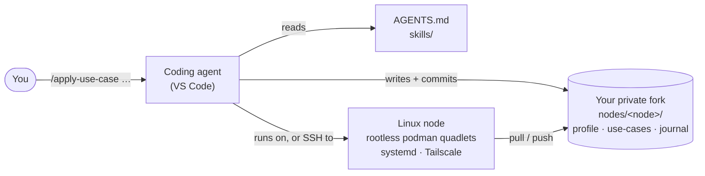

# `drydocc`

**Infrastructure-as-Markdown for AI coding agents.**
Commission, run, audit and rebuild Linux servers by writing markdown. Your
agent does the rest.

[](LICENSE)
[](https://github.com/hiemalis-at/drydocc/releases)
[](https://agentskills.io)
[](AGENTS.md)
[](docs/architecture.md)

`drydocc` is an open interface between you, your coding agent, and a small
fleet of single-purpose Linux nodes: SBCs, vServers, VMs, dedicated boxes.
It has three parts:

- **Markdown declarations.** A node profile and use-case documents in your git
  fork say what each node runs.
- **[Agent Skills](#skills).** Twenty-one skills, such as `/bootstrap-node`,
  `/apply-use-case` and `/rebuild-node`, turn those declarations into hardened
  boxes. They run services as rootless podman containers under systemd and
  reach the nodes over Tailscale.
- **An [`AGENTS.md`](AGENTS.md).** It holds the invariants every agent keeps:
  node scoping, an append-only journal, and secrets that never touch git.

There is no CLI to learn and no control plane to run. **The repository is the
infrastructure:** you fork it, and the fork is your fleet. Any agent that reads
`AGENTS.md` and loads Agent Skills can drive it. Claude Code and Mistral Vibe
are tested.

## Quickstart

Pick your door. Each one assumes the [prerequisites](#what-you-need).

### 🧑‍💻 For engineers: a fork and a first node in five steps

1. Create an **empty, private** GitHub repository, e.g. `<you>/infra`. It will
   hold hostnames and journals, so don't use the *Fork* button: that makes a
   public fork.
2. Make it a private mirror of `drydocc`:

   ```bash
   git clone https://github.com/hiemalis-at/drydocc.git infra && cd infra
   git remote rename origin upstream
   git remote add origin git@github.com:<you>/infra.git
   git push -u origin main
   code .
   ```
3. Your coding agent picks up `AGENTS.md` and the skills automatically. In its
   chat, commission a box. Use a fresh vServer or SBC with a temporary root
   password, or let the agent make a local VM:

   ```
   > /bootstrap-node vps-fra-01 "edge web node"
   ```

   Along the way it asks for a Tailscale auth key, and shows you the node's
   own deploy key to add to your fork. If it stops, fix the cause and run it
   again: it resumes.
4. Declare and run a service:

   ```
   > /create-use-case vps-fra-01 whoami "traefik/whoami, host port 8080"
   ```
5. Check it any time. The audit is read-only:

   ```
   > /audit-use-case vps-fra-01
   ```

The full walkthrough, from fork to recovery, is [`FORKING.md`](FORKING.md).
Windows users have one extra step before cloning, and it is called out there.

### 🤖 For agents: paste this into your coding agent

```text
Set up drydocc for me. Read AGENTS.md and FORKING.md in
https://github.com/hiemalis-at/drydocc, help me create my private fork of it,
then walk me through bootstrapping my first node.
```

Once it is inside a clone, [`AGENTS.md`](AGENTS.md) takes over. Its *First
contact* section tells the agent how to tell a plain clone from a ready fork,
and where to start.

### 🧪 Try it without hardware

Inside your fork, the `/lab` skill runs everything on throwaway local VMs. It
can also emulate an aarch64 board on an x86 laptop.

```
> /lab run lab/scenarios/whoami.yaml
```

A headless agent commissions a VM, creates and applies a use-case, and the run
is judged only by assertions. The first time, `/lab` helps you turn a VM from
`/provision-vm` into the base layer it clones from.

## How it works



1. **Declare.** A use-case document says which containers, volumes, ports and
   secrets a service needs.
2. **Apply.** The agent renders systemd quadlets from that declaration, starts
   them, and opens exactly the declared ports.
3. **Journal.** Every state-changing run appends a journal entry and commits
   it in the same commit as the change. It does this even when the run fails.
4. **Audit.** The audit compares the declaration with the live box and says
   which side moved. It also flags configuration that a rebuild would silently
   lose.

Every command is written to be **re-run**. It measures the distance to the
declared state, takes the smallest step that closes it, and records where it
stopped. When a run breaks, fix the cause and run it again.

## What you write

A use-case document, `nodes/vps-fra-01/use-cases/whoami.md`. You describe it
in plain words, `/create-use-case` writes it, and you can edit it like any
other file:

```yaml
---
name: whoami
status: active
owner: doccap
summary: Echoes HTTP requests back — the smallest possible service
created: 2026-10-11
last_applied: 2026-10-11T09:12:00Z
last_applied_commit: 3f2a9c1
depends_on: []
containers: [whoami]
networks: [whoami-net]
volumes: []
ports: ["8080/tcp"]
has_secrets: false
spec:
  networks:
    whoami-net: {}
  volumes: {}
  containers:
    whoami:
      image: docker.io/traefik/whoami:v1.10.3   # pinned — :latest is refused
      ports:
        - "8080:80/tcp"
---
## Intent
…
```

And the journal entry the apply left behind,
`nodes/vps-fra-01/journal/2026-10-11-0912-apply-use-case-whoami.md`:

```markdown
---
timestamp: 2026-10-11T09:12:00Z
actor: claude/<model>
trigger: /apply-use-case whoami
scope: use-case/whoami
outcome: success
commit_before: 9b1e4d0
commit_after: 3f2a9c1
mode: greenfield
---
## What was done
Rendered 1 container quadlet and 1 network; started whoami.service;
opened 8080/tcp in the node's firewall, tagged whoami.
…
```

Every file's schema is in the [`conventions`](skills/conventions/SKILL.md)
skill.

## Skills

Every skill is a standard [Agent Skills](https://agentskills.io) directory under
[`skills/`](skills/). Agents find them through `.claude/skills`, `.vibe/skills`
and `.agents/skills`, and you invoke them as `/<name>`.

<!-- skill-catalog -->
| Area | Skill | What it does |
|---|---|---|
| Node lifecycle | [`/provision-vm`](skills/provision-vm/SKILL.md) | Provisions a fresh local qemu VM, rootless where possible, for the host's architecture or an emulated one |
| | [`/bootstrap-node`](skills/bootstrap-node/SKILL.md) | Takes a fresh box to the baseline: SSH keys, hardening, tailnet, the fork cloned. Resumable |
| | [`/onboard-node`](skills/onboard-node/SKILL.md) | Adopts a box that is already running, without flattening it; running services become declarations |
| | [`/rebuild-node`](skills/rebuild-node/SKILL.md) | Whole-node disaster recovery: triage, base repair, every use-case rebuilt in order, data restored |
| Use-cases | [`/create-use-case`](skills/create-use-case/SKILL.md) | Writes a new use-case declaration from a description, then hands it to apply |
| | [`/apply-use-case`](skills/apply-use-case/SKILL.md) | Materializes a declaration on the node: volumes, secrets, quadlets, services, firewall |
| | [`/modify-use-case`](skills/modify-use-case/SKILL.md) | Changes an active use-case and restarts only what changed |
| | [`/remove-use-case`](skills/remove-use-case/SKILL.md) | Retires a use-case; keeps its data and its history |
| | [`/list-use-cases`](skills/list-use-cases/SKILL.md) | Shows what a node runs, with status and last apply and audit |
| | [`/audit-use-case`](skills/audit-use-case/SKILL.md) | Read-only drift report, declared against live, plus config a rebuild would lose |
| Data protection | [`/backup-use-case`](skills/backup-use-case/SKILL.md) | Proposes and activates volume backups to an rsync or S3-compatible target |
| | [`/restore-use-case`](skills/restore-use-case/SKILL.md) | Restores a sealed snapshot, as a scratch test or live; never deletes current data |
| Operations | [`/node-maintenance`](skills/node-maintenance/SKILL.md) | Recurring upkeep derived from the node's own inventory, with per-container telemetry baselines |
| | [`/node-notify`](skills/node-notify/SKILL.md) | Optional ntfy push alerts: failed runs, anomalies, a node gone silent |
| | [`/continue-last-command`](skills/continue-last-command/SKILL.md) | Resumes a run that paused for a secret, or that the agent itself dropped |
| Lab | [`/lab`](skills/lab/SKILL.md) | Throwaway VMs for scenario tests and prototypes, and replay-verified runbooks for real hardware |
| Building blocks | [`conventions`](skills/conventions/SKILL.md) | The authoritative schemas for every file under `nodes/` |
| | [`node-context`](skills/node-context/SKILL.md) | Binds which node a run acts on, and refuses writes outside it |
| | [`node-exec`](skills/node-exec/SKILL.md) | Runs node commands on the node itself, or over SSH from the laptop |
| | [`secrets`](skills/secrets/SKILL.md) | Resolves secrets just in time: from the environment, then KeePassXC, then a pasted `.env` |
| | [`podman-quadlets`](skills/podman-quadlets/SKILL.md) | Renders rootless podman quadlets from a use-case's `spec:` |
<!-- /skill-catalog -->

## Agents and install channels

| Agent | Instructions | Skills | Status |
|---|---|---|---|
| Claude Code | `CLAUDE.md` → `AGENTS.md` | `.claude/skills` | Tested: every lab scenario |
| Mistral Vibe | `VIBE.md` → `AGENTS.md` | `.vibe/skills` | Tested: lab `whoami` |
| Other agents that read `AGENTS.md` | `AGENTS.md` | `.agents/skills` | Untested — reports welcome |

**Cloning the fork is the install.** The skills are also listed in skill
registries, so you can find them alongside others:

```bash
npx skills add hiemalis-at/drydocc          # skills.sh
```
or 
```bash
npx @agentskill.sh/cli@latest setup         # agentskill.sh
```
then
```
/learn @hiemalis-at/<skill>                 
```
in your agent's harness.

Either way, the skills manage nodes *through a fork*. Run outside one, they
stop and point you back to the [Quickstart](#quickstart).

## What you need

**On your laptop**

- VS Code with an AI coding agent. Claude Code and Mistral Vibe are tested.
- `git` and `ssh`. `sshpass` is optional: it smooths the one-time login with a
  box's initial root password, and there is a fallback without it.
- A KeePassXC database for secret values, and a Tailscale account.
- Optional, for local VMs (`/provision-vm`, `/lab`): qemu/KVM with libvirt,
  and Python 3.

**Recommended agent skill:**
[`keepassxc-secrets`](https://skills.sh/max-win-at/keepassxc-cli-integration/keepassxc-secrets).
It fetches secrets from KeePassXC through the `kpxc-agent` CLI from the same
repository. Install it with
`npx skills add max-win-at/keepassxc-cli-integration --skill keepassxc-secrets`,
or with `/learn @max-win-at/keepassxc-secrets`. `drydocc` suggests it when it
is missing and never installs it for you. Without it, you paste secrets into a
local `.env` file instead.

**Each node**

- Any Linux machine with systemd that you can SSH into: a server, a PC, an SBC,
  a vServer, a NAS, or a VM. systemd is the one hard requirement, because
  services run as systemd-managed rootless containers. The distribution's
  tooling is discovered on the box, never assumed.
- `/bootstrap-node` installs the rest: rootless podman, Tailscale, `git`,
  `tmux`, `rsync` and Python 3.

**Optional services**

- A backup target for `/backup-use-case`: a host reachable over SSH with
  `rsync`, or an S3-compatible bucket.
- An [ntfy](https://ntfy.sh) server and the [ntfy](https://ntfy.sh) app, for `/node-notify`.

## Status

`v0`: the conventions and the command surface are settled, but a minor
release may still change them, and the [changelog](CHANGELOG.md) says when.

| Command | Verified |
|---|---|
| `/provision-vm` | On real hosts: rootless, and for an emulated architecture |
| `/bootstrap-node` | On real nodes. In the lab, unattended: resuming after a power cut mid-run, on an emulated aarch64 node, and joining a real tailnet as a fenced-off ephemeral node |
| `/onboard-node` | In the lab: adopting a hand-configured box without breaking what ran on it |
| `/create-use-case`, `/apply-use-case` | In the lab, on x86_64 and emulated aarch64: a volume, a secret, container ordering |
| `/backup-use-case`, `/restore-use-case` | In the lab: a backup to a second node, then `--test` restore |
| `/rebuild-node` | In the lab: a destroyed node brought back with its data |
| `/continue-last-command` | In the lab: the agent killed mid-run, the run finished by a new one |
| `/lab` | End to end: a prototype with restore points, extracted as a runbook, replayed on a fresh box, promoted into the fork |
| `/audit-use-case` | Its firewall read-back, on a real node |
| `/node-notify` | The ntfy channel's server behaviour, on a real node |
| `/modify-use-case`, `/remove-use-case`, `/list-use-cases`, `/node-maintenance` | Not yet run end to end |

Each recipe's *Observed dialects* table records exactly which systems a step
has been verified on.

**Not implemented yet**

- **Secret rotation.** `/node-maintenance` reports keys past their rotation
  window; performing the rotation is still manual.
- **Tailnet ACLs.** Tailscale access policy stays in the Tailscale admin
  console.
- **A journal index.** Queries read the markdown entries directly.
- **A security-patch fast path.** OS updates are one maintenance item, and a
  node is never rebooted unattended.

## Principles

- **Convergence, not one-shot correctness.** Every step is idempotent and
  journaled, so an agent only has to move downhill and write down where it
  stopped.
- **The declaration is the truth.** Quadlets and firewall rules are derived
  from it and never committed, so a node must be rebuildable from its
  declarations alone.
- **Derived, not assumed.** Distribution tooling is probed on the box and
  recorded as facts. A refusal turns on a missing capability, never on a
  distro's name.
- **Nothing happens silently.** Every change, including a failed one, appends
  to the node's journal.
- **Secrets are not git data.** Values live in KeePassXC and in a `chmod 600`
  file on the node. Git holds only key names and their purposes.
- **One fact, one level.** Invariants live in `AGENTS.md`, procedure in
  `SKILL.md` bodies, and exact syntax in `references/`.

More in [`docs/architecture.md`](docs/architecture.md).

## When to use it, and when not

**Good fit:** a handful to a few dozen single-purpose Linux nodes (a homelab,
a small company's services, edge boxes) that you want declared, auditable and
rebuildable, and whose change history should read like a logbook.

**Not a fit:** orchestration across hosts. Use Kubernetes or Nomad for that.
It is also no fit for fleets you want driven by a deterministic pipeline with
no agent in the loop, or for nodes without systemd.

## Security

- **Private by default.** Forks are private mirrors.
- **Key-only SSH.** Each node gets its own key, root login is off, and password
  login is off.
- **Revocable access.** Each node pushes with its own deploy key, so one deleted
  key cuts off a lost box.
- **Secrets out of git.** Secret values never enter the repository.

Report vulnerabilities privately; see [`SECURITY.md`](SECURITY.md).

## Docs

| Read | For |
|---|---|
| [`FORKING.md`](FORKING.md) | The admin's step-by-step path, from fork to disaster recovery |
| [`AGENTS.md`](AGENTS.md) | The agent's invariants and routing |
| [`docs/architecture.md`](docs/architecture.md) | How it is built, and the principles a change must keep |
| [`skills/conventions/`](skills/conventions/SKILL.md) | Every file schema |
| [`CHANGELOG.md`](CHANGELOG.md) | What each release changed |
| [`CONTRIBUTING.md`](CONTRIBUTING.md) | Issues, proposals, and how they land |

## Contributing

Issues and proposals are welcome. A new dialect recipe verified on a real box
is among the most useful contributions. `main` moves only by release, so
pull requests are proposals: maintainers port accepted ones and credit you.
Details are in [`CONTRIBUTING.md`](CONTRIBUTING.md).

## Naming

The name packs the model into one word:

- **dry**: re-applicable markdown;
- **do**: it acts;
- **docc**: dock, OCI containers;
- **doc**: everything is documented.

The node user that owns rootless podman and the agent's commands is
**`doccap`**, the *drydocc captain*. Framework-level variables carry a
`DOCCAP_` prefix.

## License

Apache-2.0 — see [LICENSE](LICENSE).
